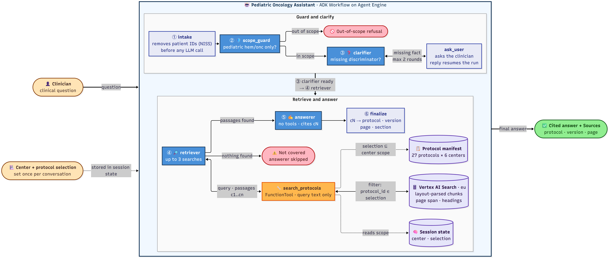
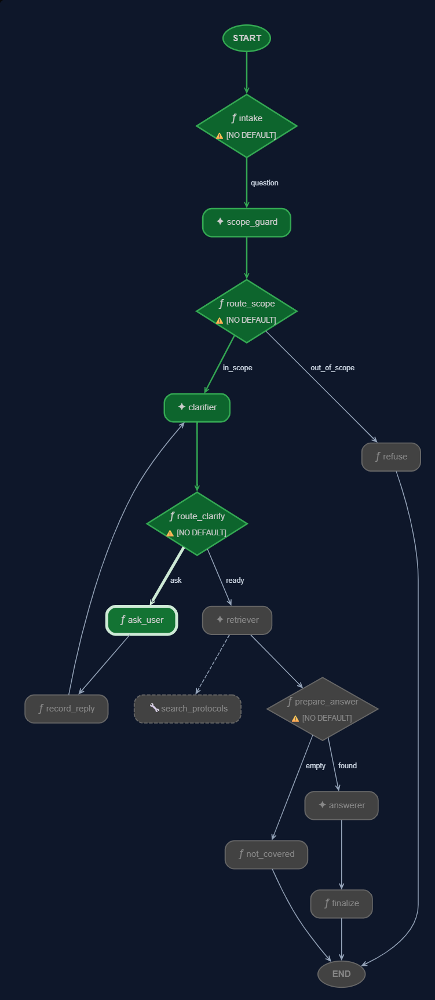
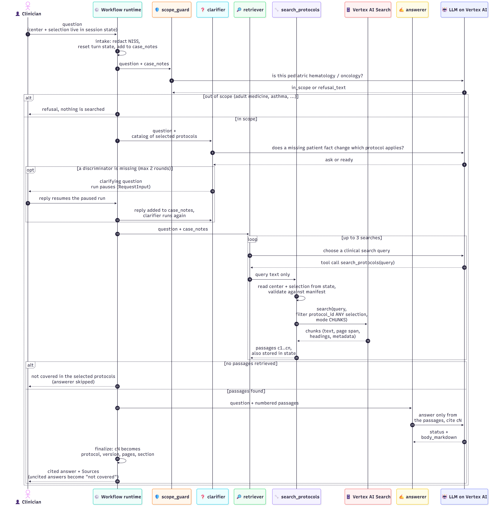
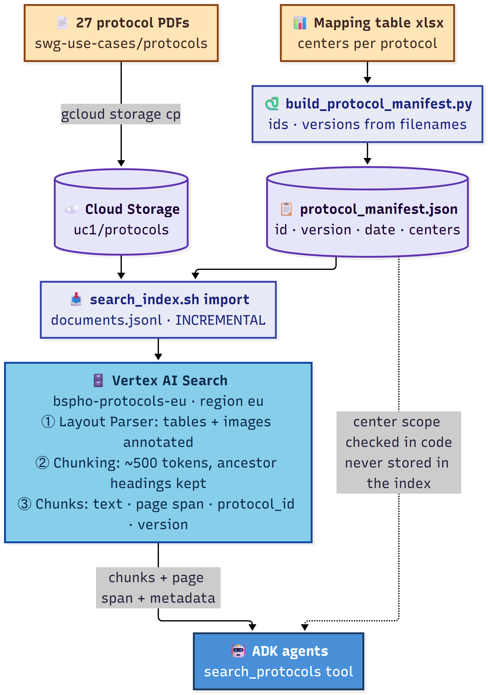
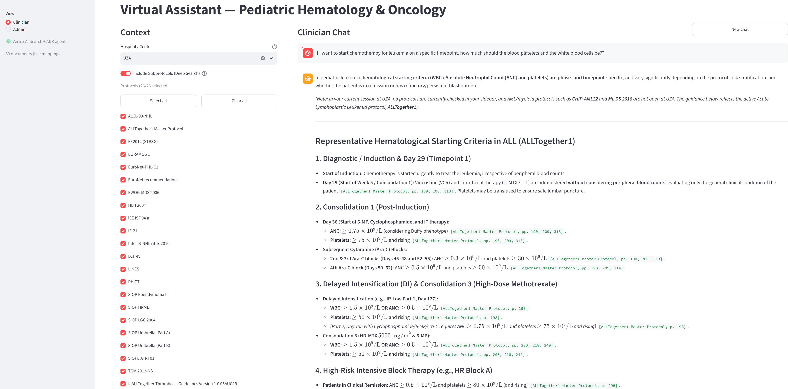
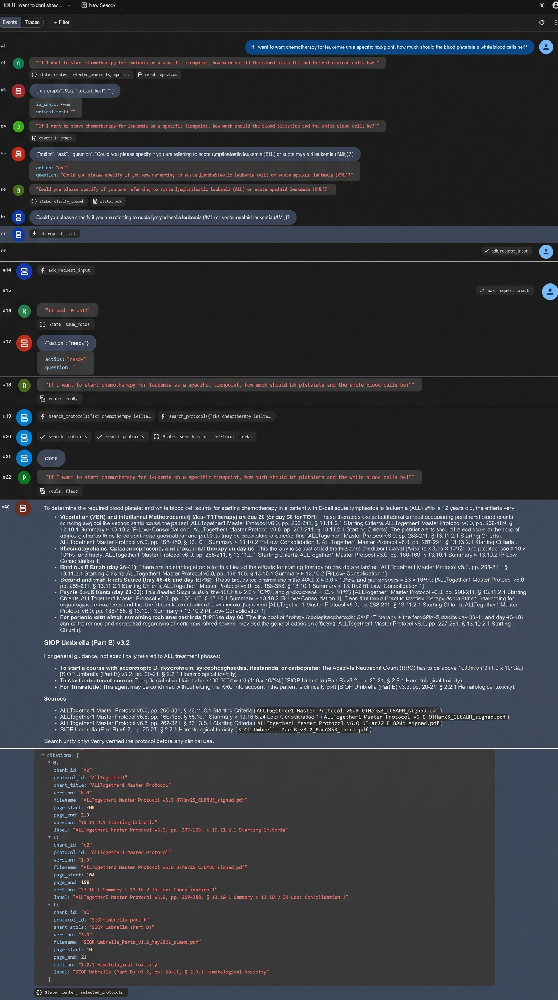

# PedOnc Agent

A virtual assistant for pediatric hematology & oncology (BSPHO).

## Project status and handoff (as of 2026-10-29)

**Scope so far:** the ADK agents and the Vertex AI Search index only. The Streamlit UI and admin flow are not built. Nothing is committed to git (branch `main`, all work uncommitted).

### Done and verified
- **Agents:** a 4-agent ADK 2.13 `Workflow` (scope guard → clarifier → retriever → answerer) in `packages/agent`. Ruff clean, strict pyright 0 errors, 73 tests passing (unit tests plus 11 scripted-model end-to-end scenarios).
- **`adk web`:** `uv run adk web packages/agent/src` discovers the app `agent`. It does not reload on code changes: restart it after edits. A numeric reply typed into its pause box arrives as a JSON number (handled in `nodes.reply_text`).
- **Live, real Gemini + real index** (2026-10-29): Q3 (FaR-RMS staging) and Q7 (ALLTogether1 stroke-like event) return cited answers such as `[FaR-RMS v2.0c, pp. 68-69, § 10. FRONTLINE (NEWLY DIAGNOSED) PATIENTS > 10.1 Frontline Assessments]`. Q5 (adult cardiology) and Q6 (asthma) are refused. Q4 "150 000 WBC" at UZG asks a clarifying question and pauses.
- **GCP** (project `qwiklabs-gcp-01-a76134d9a6dc`, account `student-01-667126a3f375@qwiklabs.net`): PDFs are in `gs://use-cases-<project>/uc1/protocols/`; data store **`bspho-protocols-eu`** (location `eu`) with Layout Parser + table/image annotation and 500-token chunks that open with their ancestor headings. All 27 protocols are imported. An older store `bspho-oncoprotocols-ds` (global, also holds sub-protocols) pre-dates this work; leave it alone.

### Not done or not verified, in suggested order
1. **Index: all 27 protocols are searchable** (checked at 14:21 local with `scripts/search_index.sh verify "treatment" <protocol_id>`, 5 chunks each). Early on, the import log reported many documents as failed with "Resource is temporarily exhausted. Processing will be retried later"; that was Google throttling layout parsing, and they indexed on their own. `scripts/search_index.sh status` counts documents that have an `indexTime`, which lags behind search, so confirm a protocol with `verify`. After adding or amending a protocol, re-run `scripts/search_index.sh import` and expect the same delay.
2. **Finish the live golden run.** Q3 and Q7 return cited answers; Q1 and Q2 are blocked by the clarifier (item 3); Q4 was not run past its clarifying question. Compare every answer with the xlsx "Suggested shortened response" (Q7's expected pages differ from what the index returned, so check which is right).
3. **Clarifier is too eager. This is the main quality problem and the next thing to fix.** Live: Q1 (dinutuximab start criteria) asks for stage, MYCN status and relapsed vs newly diagnosed, although the golden answer is a direct answer from BEACON2 and HR-NBL2. Q2 (staging a 3-year-old, no MYCN amplification) asks for the clinical stage, which is what the protocol answers. Q4 asks for leukemia type, age, Down syndrome and KMT2A, asks again when the reply does not answer, and at UZA still asks AML vs ALL although CHIP-AML22 is not run there. The clarifier only sees protocol titles. Only Q4 (AML vs ALL) is meant to trigger a question. Options: tighten `prompts.clarifier_instruction` to ask only when different selected protocols would give different answers and never for facts the protocol itself resolves; give it a short disease/age summary per protocol in the manifest; or let it search first and ask only when the passages branch.
4. **Inline citations are long and repeat.** Each bullet carries the full `[Protocol vX, pages, § section path]`. The requirement is title, version, page and section, so it is correct, but consider short inline labels (protocol, version, pages) with the section in the Sources list.
5. **Write the `adk eval` set** for Golden Q1–Q7 plus the two UZA scope cases (Q1 at UZA → Not Covered; Q4 at UZA → no clarifying question). Not written.
6. **Entry point for the UI.** The design promises one `send` / `resume` function; it does not exist yet (only `root_agent` for adk web). Build it with the Streamlit UI per [design/ui-implementation-plan.md](design/ui-implementation-plan.md). Resuming a pause needs the `adk_request_input` interrupt id and `invocation_id` (see `tests/test_workflow.py::Chat.answer_question`).
7. **Manifest gaps:** six protocols have no version in their filename (`alcl-99-nhl`, `beacon2`, `hlh-2004`, `hrnbl2`, `euronet-recommendations`, `ewog-mds-2006`), and a few versions are guesses (`ewog-saa-2010`="Final", `inter-b-nhl-ritux-2010`="4", `siop-lgg-2004`="I"). Fill them from the PDF title pages in `scripts/build_protocol_manifest.py` (`VERSIONS`), rebuild the manifest, and re-run `scripts/search_index.sh import`.
8. **Admin flow, feedback buttons, Deep Search (sub-protocols), and the Dutch patient folder (Golden Q8/Q9)** are deferred; see Requirements.

## Problem Statement
Clinicians and researchers in pediatric hematology and oncology at Belgian centers (`UZA`, `UZG`, `UZL`, `HUDERF`, `UCL`, `CHU`) face a critical, time-consuming challenge when retrieving medical protocol details during clinical shifts:
- **Manual & Complex Search:** Practitioners must manually sift through thousands of pages of dense clinical trial protocols (150–400+ pages each) containing complex stratification flowcharts, charts, images, dose tables, and cross-references.
- **Fragmented Information:** While the BSPHO (Belgian Society of Paediatric Haematology Oncology) website hosts general treatment guidelines, individual hospitals only participate in specific subsets of trials and maintain local guidelines.
- **Constant Amendments:** Protocols and supporting documents receive frequent updates and amendments, making it difficult to ensure clinicians are consulting the latest active version.

**Goal:** Build an intelligent, zero-hallucination search assistant (NotebookLM-style UI) that enables pediatric oncologists to navigate clinical trial protocols and subprotocols quickly, accurately, and safely with strict source grounding.

---

## Requirements (Hackathon Prioritization)

Given the few-hour hackathon timeframe, requirements are split between **Core MVP (Must-Haves)** and **Nice-to-Have Features (Stretch Goals)**.

### 1. Core MVP Requirements (Must-Haves)
- **Strict Grounding & Inline Citations:**
  - Base all medical facts, criteria, regimens, and timepoints strictly on the provided English BSPHO protocols.
  - Provide inline citations for every claim with **Document Title** and **Page Number** (and section where applicable).
  - Parse both text and visual elements (charts, tables, flowcharts) within protocols.
- **2-Tier Context (see [GLOSSARY.md](GLOSSARY.md)):**
  - **Tier 1 — Center Scope:** Upon (mocked) BSPHO authentication, the backend restricts the protocols to those the user's center (`UZA`, `UZG`, `UZL`, `HUDERF`, `UCL`, `CHU`) participates in, per the provided mapping table. Auth/portal integration is out of scope, but the backend is built as if the center came from auth (mocked via a center dropdown).
  - **Tier 2 — Protocol Selection:** Left-hand sidebar listing the Center Scope protocols with checkboxes so the clinician can check/uncheck specific protocols to scope their question.
- **Conversational Search & Proactive Clarification:**
  - If a clinician's query is ambiguous or depends on missing clinical discriminators (e.g., patient age, risk group, treatment phase, `AML` vs. `ALL`, `MYCN` status), proactively ask clarifying questions before providing a definitive protocol answer.
- **Clinical Guardrails & Persona:**
  - Act purely as a search utility (not a medical device) using a professional, medical tone of voice.
  - **Zero Hallucination / Refusal:** Explicitly state if an answer is not covered in the selected documents or is out of scope (e.g., adult medicine or non-oncology queries) rather than guessing.
- **Lightweight Admin / Document Management Workflow:**
  - A simple admin interface/workflow to upload new PDF protocols or amendments (e.g., to Google Cloud Storage), tag applicable hospitals/centers, and trigger automatic re-indexing.

### 2. Nice-to-Have Features (Should-Haves & Could-Haves)
- **Sub-protocol "Deep Search" (Should-Have — deferred, not in current build):**
  - Offer to search across supporting documents / sub-protocols (e.g., `ALLTogether1` sub-protocols for thrombosis, pancreatitis, etc.) when relevant to the query. Deep Search is a separate feature, not a "tier".
- **User Feedback UI (Should-Have):**
  - Thumbs up / thumbs down buttons on assistant responses to collect clinician feedback.
- **Cost-Effective Retrieval Architecture (Should-Have):**
  - Optimize indexing/chunking/caching so large 400-page PDFs do not incur excessive token costs per query.
- **Interactive PDF Viewer / Clickable Citations (Could-Have):**
  - Clicking an inline citation opens or scrolls to the exact page in a side-by-side PDF viewer (NotebookLM style).
- **Multi-Language / Lay Translation (Could-Have):**
  - Ability to translate or summarize protocol information into lay Dutch/Flemish for patient/parent communication when explicitly requested.
- **External PubMed Search (Could-Have):**
  - Option to query PubMed for supplementary literature on older protocols (with clear separation from grounded protocol facts).

### 3. Out of Scope (Won't-Haves for Hackathon)
- Actual authentication and integration into the live BSPHO web portal.

---

## Expected Inputs
1. **Runtime User Inputs:**
   - **Hospital / Center Context:** Selected Belgian center (`UZG`, `UZA`, `UZL`, `HUDERF`, `UCL`, `CHU`).
   - **Protocol Selection:** Subset of the Center Scope toggled on/off by the user in the left-hand panel.
   - **Clinician Query:** Open-ended natural language medical question or follow-up clarification response (e.g., *"If I want to start chemotherapy for leukemia on a specific timepoint, how much should the blood platelets and white blood cells be?"*).
2. **Knowledge Base / Static Inputs (Provided Dataset):**
   - **Master Protocols (`27 PDFs`):** Clinical trial protocols in `docs/1. Virtual Assistant/protocols/`.
   - **Subprotocols (`5 PDFs`):** Supporting guidelines in `docs/1. Virtual Assistant/subprotocols/`.
   - **Mapping Table & Golden Dataset (`SwG-UC1-Golden Dataset and mapping table.xlsx`):** Hospital-to-protocol participation matrix and the Golden Dataset: 8 Q&A scenarios in the spreadsheet (`Q1`–`Q8`), plus `Q9` = the Dutch FaR-RMS patient folder (`Golden Dataset_Question9_FaR-RMS_patientenfolder-3.pdf`).
   - **Source of truth:** the BSPHO deck (`SwG 2026_UC1_Pediatric Hematology & Oncology.pptx`) for requirements, the spreadsheet for participation and expected answers. The quickstart lab (`uc1-oncoprotocol-quickstart.lab.md`) is illustrative only.
3. **Admin Inputs:**
   - New or amended PDF protocol file + selected list of participating hospitals.

---

## Expected Outputs
1. **Grounded Clinical Response:**
   - Clear, structured medical answer derived strictly from the active protocols (or a polite out-of-scope refusal if not covered).
2. **Inline Source Citations:**
   - Explicit references containing `[Document Title, Version, Page #, Section]` for quick clinician verification.
3. **Clarifying Questions (When Applicable):**
   - Targeted follow-up prompts when a query spans multiple protocols or requires patient stratification details (risk group, age, disease subtype) before an accurate answer can be given.
4. **Updated Knowledge Index (Admin Flow):**
   - Confirmation of PDF upload, hospital mapping update, and re-indexing status so the new protocol immediately appears in the relevant hospital's sidebar.

---

## Solution Design

The architecture separates the **UI & Document Management Layer** from the **AI Solution Layer (Google ADK 2.13 `Workflow` + Vertex AI Search)**. Domain terms are defined in [GLOSSARY.md](GLOSSARY.md); significant decisions are recorded in [docs/adr/](docs/adr/).

### 1. Architecture diagrams

Sources are the Mermaid files in [docs/diagrams/](docs/diagrams/); the images below are rendered from them. After editing a `.mmd` file, re-render it with `npx -y @mermaid-js/mermaid-cli -i <file>.mmd -o <file>.png -b white -s 2`.



[Diagram source (Mermaid)](docs/diagrams/agent_01_flowchart_workflow.mmd)

#### 1.1 Agent workflow

Four LLM agents (blue) and three function nodes run as one ADK 2.13 `Workflow`. The retriever is the only agent with a tool; the tool is the only code that touches the search index, and it takes nothing from the model except the query text.


| Colour | Meaning |
|---|---|
| Beige (outside the box) | Input from the clinician: the question, and the center and protocol selection set once per conversation |
| Outlined box | The deployed assistant; only the cited answer leaves it |
| Blue | LLM agent (Gemini 2.5 Flash-Lite for the guard, Flash for the rest) |
| Light blue-grey | Function node: plain code, no model call |
| Orange | Tool the retriever agent calls |
| Purple | Data: session state, manifest, search index |
| Red | Early exit with no answer (refusal, not covered) |
| Green | The cited answer |

#### 1.2 One question, step by step

What happens for a single question, including the pause for a clarifying question and the retrieval loop. The scope check, filter building and citation resolution all happen in code, not in the model.



[Diagram source (Mermaid)](docs/diagrams/agent_02_sequence_question_turn.mmd)

#### 1.3 Knowledge base and indexing

How the protocol PDFs and the center mapping become searchable chunks. Center participation stays in the manifest and is checked in code, so changing it never needs a re-index.



[Diagram source (Mermaid)](docs/diagrams/agent_03_flowchart_knowledge_base.mmd)

### 2. AI Solution Layer

**Framework:** `google-adk==2.13.0` (pinned). The chain is an ADK 2 **`Workflow`** graph; the deprecated `SequentialAgent` is not used.

**Agent topology — chain of agents** ([ADR 0001](docs/adr/0001-chain-of-agents.md)):

```text
START → scope_guard → route_scope ─┬─ out_of_scope → refusal
                                   └─ in_scope → clarifier → route_clarify ─┬─ ask   → RequestInput (pause)
                                                                            └─ ready → retriever → answerer
```

`scope_guard` and `clarifier` are `LlmAgent`s with an `output_schema`; `route_scope` / `route_clarify` are small `@node` functions that read that output and emit the route. Edges are validated when the `Workflow` is built.

| Node | Model | Responsibility |
|---|---|---|
| `scope_guard` | Gemini Flash-Lite | Passes anything in pediatric hematology/oncology (even if the selected protocols may not cover it); emits an **Out-of-Scope Refusal** only for adult medicine or non-hem/onc topics (Golden Q5, Q6). Output: `{in_scope, refusal_text}`. A `before_model_callback` redacts NISS/INSZ and similar identifiers before any text reaches Gemini. |
| `clarifier` | Gemini Flash | Sees the conversation so far (`case_notes`) + a **protocol catalog** of the Protocol Selection (label and title) — no protocol text. Asks a **Clarifying Question** only when a missing Clinical Discriminator would point to *different selected protocols* (e.g. Q4 "150,000 WBC": asks AML vs ALL at UZG, does not ask at UZA where CHIP-AML22 is not in scope). Asks for all missing discriminators in **one** question, at most twice per question, via `RequestInput`. The reply resumes the paused run and goes back to the clarifier (the scope guard is not re-run). If the clinician types a normal message instead, a new turn starts and the scope guard sees the earlier turns through `case_notes`. |
| `retriever` | Gemini Flash | Rewrites the question into at most 3 searches (clinical synonyms, one per protocol when several are selected) and calls `search_protocols(query)`. Accumulates chunks in state with stable ids `c1…cn`. Produces no user-facing text. |
| `answerer` | Gemini Flash | No tools. `output_schema` `{status: answered or not_covered, body_markdown}` with inline `[cN]` markers. When the protocol text branches (risk group, treatment phase), gives a concise per-branch answer, each branch cited, ending with an offer to narrow down. Answers **Not Covered** when nothing relevant was retrieved — never from model knowledge. |

**Citations:** the `finalize` node validates every `[cN]` against chunks retrieved *this turn* and resolves it to Protocol, Version, page and section; unknown ids are stripped and logged. An answer left with no valid citation is replaced by Not Covered, and when nothing was retrieved the `prepare_answer` node skips the answerer entirely. The model never writes a page number itself. The final event's `output` carries the structured citations for the UI to render as badges.

**Scope enforcement** ([ADR 0002](docs/adr/0002-scope-enforced-outside-the-model.md)): the UI writes the clinician's Center and Protocol Selection into ADK **session state**. `search_protocols` reads them from `tool_context.state`, re-validates the selection against the Mapping Table (selection ⊆ Center Scope), and builds the Vertex AI Search filter `protocol_id: ANY(...)` itself. The model only supplies query text. If the answer exists only outside the selection the assistant says **Not Covered**, hinting to check the sidebar when the protocol is in the Center Scope but unchecked; it never searches or reveals content outside the Center Scope.

**Search integration:** a custom ADK `FunctionTool` using `google-cloud-discoveryengine` `SearchService` in `CHUNKS` mode (not ADK's built-in `VertexAiSearchTool`, not the Answer API), returning chunk text, page span, section heading, protocol ID and version.

**Runtime:** `adk web` today. Planned: in-process ADK `Runner` + `InMemorySessionService` behind a single entry point the UI calls (start a turn / resume a paused `RequestInput`; not written yet), so it can later move to `adk api_server` / Agent Engine without UI changes. Gemini on Vertex AI in `europe-west1` (`gemini-2.5-flash`, guard on `gemini-2.5-flash-lite`; the `gemini-3*` names return 404 in this project); Vertex AI Search in the `eu` multi-region.

**Deferred:** Deep Search (sub-protocols) and the Dutch patient folder (Golden Q8/Q9 — a future separate agent).

### 3. Search & Knowledge Base

- **Protocol manifest** (`packages/agent/src/agent/data/protocol_manifest.json`): generated by `scripts/build_protocol_manifest.py` from the Mapping Table plus versions parsed from filenames: `protocol_id` (slug of Short Title, e.g. `far-rms`), `short_title`, `title`, `version`, `version_date`, `doc_type`, participating centers. It produces `metadata.jsonl` for import and the Mapping Table used by the tool.
- **Vertex AI Search document:** id = `protocol_id`; structured metadata `protocol_id, short_title, title, version, version_date, doc_type`. **Center participation is not stored in the index** — it is checked in code, so changing participation never requires re-indexing.
- **Ingestion:** unstructured data store, Layout Parser with table and image annotation (flowcharts, dose tables), ~500-token chunks with `include_ancestor_headings=true` (section headings travel with each chunk). Only the 27 protocols are imported; sub-protocols are not.
- **Amendments:** an amendment **replaces** the previous version under the same `protocol_id`; one searchable version per protocol, and every citation shows the version.

### 4. Evaluation

Planned, not written yet: Golden Q1–Q7 become an ADK eval set (`adk eval`). Each case seeds Center + Protocol Selection in initial session state; an LLM judge scores against the "Suggested shortened response". Extra scope cases: Q1 at UZA → Not Covered; Q4 at UZA → no Clarifying Question.

### 5. UI & Document Management Layer

See [design/ui-implementation-plan.md](design/ui-implementation-plan.md).
- **Clinician view:** center selector (stand-in for auth) → Protocol Selection checklist → chat with citation badges.
- **Admin view:** upload a new protocol or amendment, tick participating centers (updates the manifest / `metadata.jsonl`), and trigger an `INCREMENTAL` Vertex AI Search import.

### 6. Run it (adk web)

```bash
uv sync --all-packages
gcloud auth application-default login          # once; the agent calls Gemini and Vertex AI Search
cp packages/agent/src/agent/.env.example packages/agent/src/agent/.env   # then set GOOGLE_CLOUD_PROJECT
uv run adk web packages/agent/src               # open http://127.0.0.1:8000, pick app "agent"
```

Until the Streamlit UI exists, set the Center Scope and Protocol Selection from the chat itself:
`/center UZA`, `/select far-rms,lch-iv` (or `/select all`), `/scope` to review, `/new` to forget
earlier context. The default is center UZG with every protocol selected.

Index maintenance (needs `CLOUDSDK_PYTHON` set to gcloud's bundled Python on managed Windows hosts):
`scripts/search_index.sh create | import | operations | status | verify "query" [protocol_id...]`.
The manifest is regenerated with `uv run --with openpyxl python scripts/build_protocol_manifest.py`.

### 7. Project Structure

`uv` workspace. Checks before calling work done: `uv run ruff check --fix . && uv run ruff format . && uv run pyright && uv run pytest`.

```text
swg_2026_va/
├── packages/
│   ├── agent/
│   │   ├── src/agent/
│   │   │   ├── agent.py            # root_agent for adk web
│   │   │   ├── workflow.py         # the Workflow graph
│   │   │   ├── agents.py           # the four LlmAgents
│   │   │   ├── nodes.py            # function nodes: intake, routing, pause, finalize
│   │   │   ├── prompts.py          # instruction providers
│   │   │   ├── tools/search_protocols.py
│   │   │   ├── search.py           # Vertex AI Search client + ChunkSearcher seam
│   │   │   ├── scope.py  manifest.py  commands.py  state.py
│   │   │   ├── citations.py  pii.py  events.py  extract.py  config.py
│   │   │   └── data/protocol_manifest.json
│   │   └── tests/                  # unit + scripted-model end-to-end tests
│   └── ui/                         # Streamlit UI (not built yet)
├── scripts/                        # index creation/import/verify, manifest builder
├── docs/adr/  docs/diagrams/  design/  GLOSSARY.md  AGENTS.md
└── swg-use-cases/                  # provided dataset (gitignored)
```
### 8. UI



