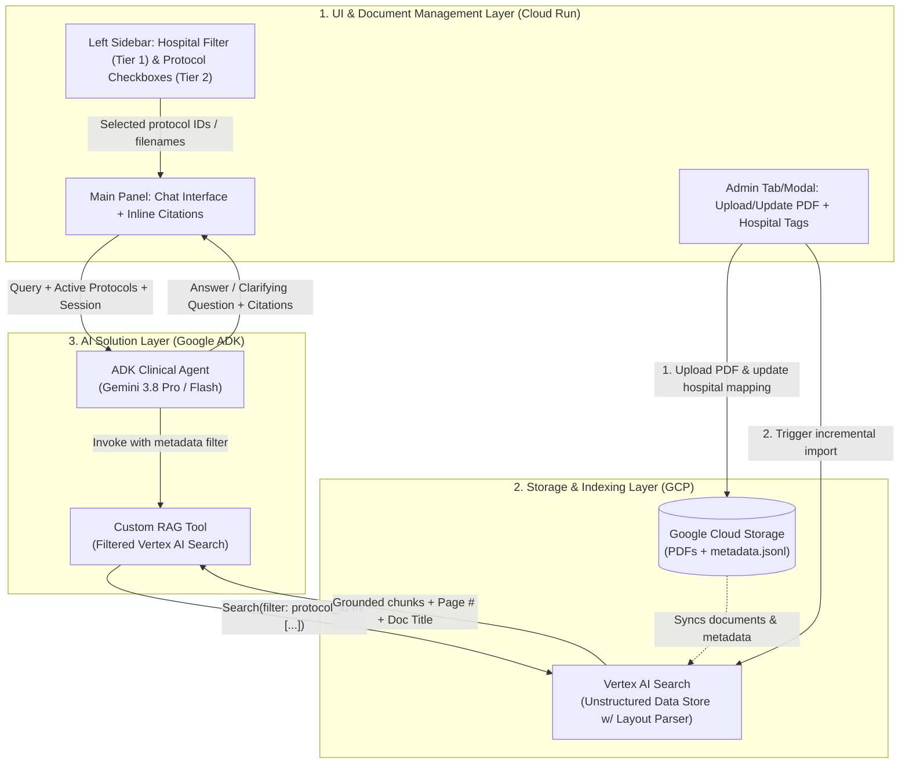

# Virtual Assistant in Pediatric Hematology & Oncology (BSPHO)

## Problem Statement
Clinicians and researchers in pediatric hematology and oncology at Belgian centers (`UZA`, `UZG`, `UZL`, `HUDERF`, `UCL`, `CHU`) face a critical, time-consuming challenge when retrieving medical protocol details during clinical shifts:
- **Manual & Complex Search:** Practitioners must manually sift through thousands of pages of dense clinical trial protocols (150–400+ pages each) containing complex stratification flowcharts, charts, images, dose tables, and cross-references.
- **Fragmented Information:** While the BSPHO (Belgian Society of Paediatric Haematology Oncology) website hosts general treatment guidelines, individual hospitals only participate in specific subsets of trials and maintain local guidelines.
- **Constant Amendments:** Protocols and supporting documents receive frequent updates and amendments, making it difficult to ensure clinicians are consulting the latest active version.

**Goal:** Build an intelligent, zero-hallucination search assistant (NotebookLM-style UI) that enables pediatric oncologists to navigate clinical trial protocols and subprotocols quickly, accurately, and safely with strict source grounding.

---

## Requirements (Hackathon Prioritization)

Given the few-hour hackathon timeframe, requirements are split between **Core MVP (Must-Haves)** and **Nice-to-Have Features (Stretch Goals)**.

### 1. Core MVP Requirements (Must-Haves)
- **Strict Grounding & Inline Citations:**
  - Base all medical facts, criteria, regimens, and timepoints strictly on the provided English BSPHO protocols.
  - Provide inline citations for every claim with **Document Title** and **Page Number** (and section where applicable).
  - Parse both text and visual elements (charts, tables, flowcharts) within protocols.
- **2-Tier Context & Hospital Filtering:**
  - **Tier 1 (Hospital/Center Filter):** Filter available protocols based on the user's hospital (`UZA`, `UZG`, `UZL`, `HUDERF`, `UCL`, `CHU`) using the provided Hospital-Protocol mapping table (e.g., mocked via a hospital selector/dropdown in the UI).
  - **Tier 2 (Protocol Selection UX):** Left-hand sidebar listing the applicable protocols for the selected hospital with checkboxes so the clinician can check/uncheck specific protocols to scope their query.
- **Conversational Search & Proactive Clarification:**
  - If a clinician's query is ambiguous or depends on missing clinical discriminators (e.g., patient age, risk group, treatment phase, `AML` vs. `ALL`, `MYCN` status), proactively ask clarifying questions before providing a definitive protocol answer.
- **Clinical Guardrails & Persona:**
  - Act purely as a search utility (not a medical device) using a professional, medical tone of voice.
  - **Zero Hallucination / Refusal:** Explicitly state if an answer is not covered in the selected documents or is out of scope (e.g., adult medicine or non-oncology queries) rather than guessing.
- **Lightweight Admin / Document Management Workflow:**
  - A simple admin interface/workflow to upload new PDF protocols or amendments (e.g., to Google Cloud Storage), tag applicable hospitals/centers, and trigger automatic re-indexing.

### 2. Nice-to-Have Features (Should-Haves & Could-Haves)
- **Subprotocol "Deep Search" (Should-Have):**
  - Escalate or offer to search across supporting documents / subprotocols (e.g., `ALLTogether1` subprotocols for thrombosis, pancreatitis, etc.) when relevant to the query.
- **User Feedback UI (Should-Have):**
  - Thumbs up / thumbs down buttons on assistant responses to collect clinician feedback.
- **Cost-Effective Retrieval Architecture (Should-Have):**
  - Optimize indexing/chunking/caching so large 400-page PDFs do not incur excessive token costs per query.
- **Interactive PDF Viewer / Clickable Citations (Could-Have):**
  - Clicking an inline citation opens or scrolls to the exact page in a side-by-side PDF viewer (NotebookLM style).
- **Multi-Language / Lay Translation (Could-Have):**
  - Ability to translate or summarize protocol information into lay Dutch/Flemish for patient/parent communication when explicitly requested.
- **External PubMed Search (Could-Have):**
  - Option to query PubMed for supplementary literature on older protocols (with clear separation from grounded protocol facts).

### 3. Out of Scope (Won't-Haves for Hackathon)
- Actual authentication and integration into the live BSPHO web portal.

---

## Expected Inputs
1. **Runtime User Inputs:**
   - **Hospital / Center Context:** Selected Belgian center (`UZG`, `UZA`, `UZL`, `HUDERF`, `UCL`, `CHU`).
   - **Selected Protocols:** Subset of active protocols toggled on/off by the user in the left-hand panel (plus optional toggle/escalation for subprotocols).
   - **Clinician Query:** Open-ended natural language medical question or follow-up clarification response (e.g., *"If I want to start chemotherapy for leukemia on a specific timepoint, how much should the blood platelets and white blood cells be?"*).
2. **Knowledge Base / Static Inputs (Provided Dataset):**
   - **Master Protocols (`27 PDFs`):** Clinical trial protocols in `docs/1. Virtual Assistant/protocols/`.
   - **Subprotocols (`5 PDFs`):** Supporting guidelines in `docs/1. Virtual Assistant/subprotocols/`.
   - **Mapping Table & Golden Dataset (`SwG-UC1-Golden Dataset and mapping table.xlsx`):** Hospital-to-protocol participation matrix and 9 evaluation Q&A scenarios (`Q1`–`Q9`).
3. **Admin Inputs:**
   - New or amended PDF protocol file + selected list of participating hospitals.

---

## Expected Outputs
1. **Grounded Clinical Response:**
   - Clear, structured medical answer derived strictly from the active protocols (or a polite out-of-scope refusal if not covered).
2. **Inline Source Citations:**
   - Explicit references containing `[Document Title, Version, Page #, Section]` for quick clinician verification.
3. **Clarifying Questions (When Applicable):**
   - Targeted follow-up prompts when a query spans multiple protocols or requires patient stratification details (risk group, age, disease subtype) before an accurate answer can be given.
   - Prompt asking the user if they want to perform a deep dive into subprotocols when relevant.
4. **Updated Knowledge Index (Admin Flow):**
   - Confirmation of PDF upload, hospital mapping update, and re-indexing status so the new protocol immediately appears in the relevant hospital's sidebar.

---

## Solution Design (Draft v1)

The architecture strictly separates the **Web UI & Document Management Layer** from the **AI Solution Layer (Google ADK Agent + Vertex AI Search)** so both can be developed, tested, and deployed rapidly during the hackathon.

### 1. High-Level Architecture



---

### Agent workflow (v2)

Four LLM agents (blue) and three function nodes run as one ADK 2.13 `Workflow`. The retriever is the only agent with a tool; the tool is the only code that touches the search index, and it takes nothing from the model except the query text.


### 2. Functional Separation

#### A. AI Solution Layer (Google ADK Agent + Vertex AI Search)
The AI layer is a standalone Python module (`agent/`) built with the **Google Agent Development Kit (ADK)** that exposes a clean agent interface:
- **Core Model:** `gemini-3.8-flash` (fast, cost-effective for multi-turn search).
- **System Instructions (Guardrails & Persona):**
  - Enforces the pediatric oncology persona, strict adherence to English BSPHO protocols, and out-of-scope refusals.
  - Instructs the agent to check if a clinical query depends on missing patient variables (e.g., `AML` vs. `ALL`, risk group, age, `MYCN` status) and ask a clarifying question *before* giving a final treatment recommendation.
  - Formats every factual claim with `[Document Title, Page #]`.
- **Tools:**
  1. `search_protocols(query: str, selected_protocols: list[str], include_subprotocols: bool = False)`
     - Queries **Vertex AI Search** (`discoveryengine` API) restricted only to the `selected_protocols` passed from the UI (using filter expressions or document URI filtering).
     - Returns extracted text/table chunks along with exact **document title** and **page number** metadata.
  2. *(Optional Stretch)* `search_subprotocols(query: str)`
     - Triggered when the user confirms they want a deep dive into the 5 `ALLTogether1` subprotocols.

#### B. Search & Knowledge Base (Vertex AI Search + GCS)
- **Google Cloud Storage (GCS):**
  - `gs://<bucket>/protocols/` — Stores the 27 master protocol PDFs and any newly uploaded/updated PDFs.
  - `gs://<bucket>/subprotocols/` — Stores the 5 subprotocol PDFs.
  - `gs://<bucket>/metadata/` — Stores the Hospital-to-Protocol mapping (`hospital_mapping.json`) and a JSONL metadata manifest (`metadata.jsonl`) linking each PDF URI to its `protocol_id`, `doc_type` (`protocol` vs `subprotocol`), and participating `hospitals` (`["UZG", "UZA", ...]`).
- **Vertex AI Search Data Store:**
  - Configured for **Unstructured Documents (PDF)** with **Layout Parser** and **Chunking** enabled (preserves tables, charts, and page numbers in chunk metadata).
  - Supports metadata filtering so the ADK tool only retrieves chunks from the protocols checked in the user's UI sidebar.

#### C. UI & Document Management Layer
A lightweight web application (`app/`) deployed on **Cloud Run** that communicates with the ADK Agent and GCS/Vertex AI Search:
- **Clinician View (NotebookLM-style 2-Column Layout):**
  - **Left Panel:**
    - **Tier 1:** Dropdown to select the clinician's hospital (`UZG`, `UZA`, `UZL`, `HUDERF`, `UCL`, `CHU`).
    - **Tier 2:** Checklist of protocols active at that hospital (auto-populated from the mapping table), plus a toggle for "Include Subprotocols (Deep Search)".
  - **Main Panel:** Conversational chat interface rendering markdown answers and clear `[Protocol, Page #]` citation badges.
- **Admin / Document Sync View:**
  - File uploader to add a new PDF or overwrite an amended PDF directly in `gs://<bucket>/protocols/`.
  - Multi-select checkboxes to assign which Belgian hospitals participate in this protocol (updates `hospital_mapping.json` and `metadata.jsonl` in GCS).
  - **"Sync & Re-index" button:** Calls the Vertex AI Search `import_documents` API (`INCREMENTAL` reconciliation mode) to index the new/updated PDF from GCS automatically.

---

### 3. Confirmed Tech Stack & Project Structure (`uv` Workspace)

- **Workspace Management:** **`uv` Workspace** (`pyproject.toml` + `packages/*`) cleanly separating the `agent` and `ui` packages.
- **UI Framework:** **Streamlit** (`packages/ui/src/ui/app.py`) — Provides sidebar checkboxes for Tier 1 (Hospital selector) and Tier 2 (Protocol selection), conversational chat UI, and an Admin document upload tab.
- **AI Solution Layer:** **Google ADK (`google-adk`)** (`packages/agent/src/agent/`) — Decoupled into a standalone workspace package invoked via ADK's `Runner` & `InMemorySessionService`.
- **Search Integration:** **Custom Python `FunctionTool`** (`packages/agent/src/agent/tools.py`) using `google-cloud-discoveryengine` to query Vertex AI Search with dynamic filtering based on the user's checked protocols and returning chunk text + exact page numbers.
- **Infrastructure & Deployment:**
  - Automated setup script (`scripts/setup_gcp.py`) to create the GCS bucket, generate `metadata.jsonl` from the Excel hospital mapping table, upload the 27 protocols + 5 subprotocols, and provision/import into the Vertex AI Search Data Store.
  - Containerized using `uv` and deployed to **Google Cloud Run** as a single service (`deploy/Dockerfile.ui`; the hardened root `Dockerfile` is not in use yet — see its KNOWN ISSUE banner).
  - See **[`SINGLE_CLOUD_RUN_DEPLOYMENT.md`](SINGLE_CLOUD_RUN_DEPLOYMENT.md)** for the full `gcloud` runbook.

```text
swg_2026_va/
├── pyproject.toml                  # Root uv workspace configuration
├── uv.lock                         # Locked workspace dependencies
├── Dockerfile                      # Hardened Cloud Run image (NOT in use — see its KNOWN ISSUE banner)
├── .dockerignore
├── SINGLE_CLOUD_RUN_DEPLOYMENT.md  # gcloud deployment runbook (single service)
├── packages/
│   ├── agent/                      # AI Solution Package (Standalone ADK Agent)
│   │   ├── pyproject.toml
│   │   └── src/agent/
│   │       ├── __init__.py
│   │       ├── agent.py            # Root ADK Agent definition, system prompt & guardrails
│   │       └── tools.py            # Custom Vertex AI Search FunctionTool (filtered RAG)
│   └── ui/                         # UI & Document Management Package
│       ├── pyproject.toml
│       └── src/ui/
│           ├── __init__.py
│           ├── app.py              # Streamlit UI (Sidebar filters, Chat, Admin Upload)
│           └── gcs_sync.py         # GCS PDF upload, mapping update & VAIS re-index trigger
├── scripts/                        # Infrastructure & Data Provisioning
│   └── setup_gcp.py                # Creates GCS bucket, metadata.jsonl, and VAIS Data Store
├── data/                           # Provided dataset & processed JSON/JSONL manifests
│   ├── 1. Virtual Assistant/       # Raw PDFs, Excel mapping & Golden Dataset
│   └── processed/                  # Generated hospital_mapping.json & metadata.jsonl
└── deploy/                         # Cloud Build & deployment helpers
    ├── Dockerfile.ui               # Cloud Run image currently deployed
    ├── cloudbuild.yaml             # Selects which Dockerfile to build
    └── env.sh                      # Shared deployment variables
```
